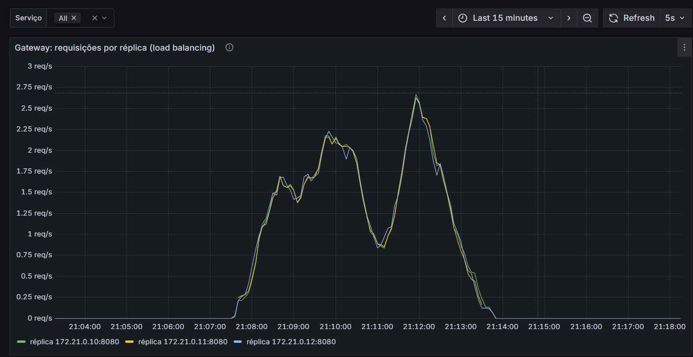
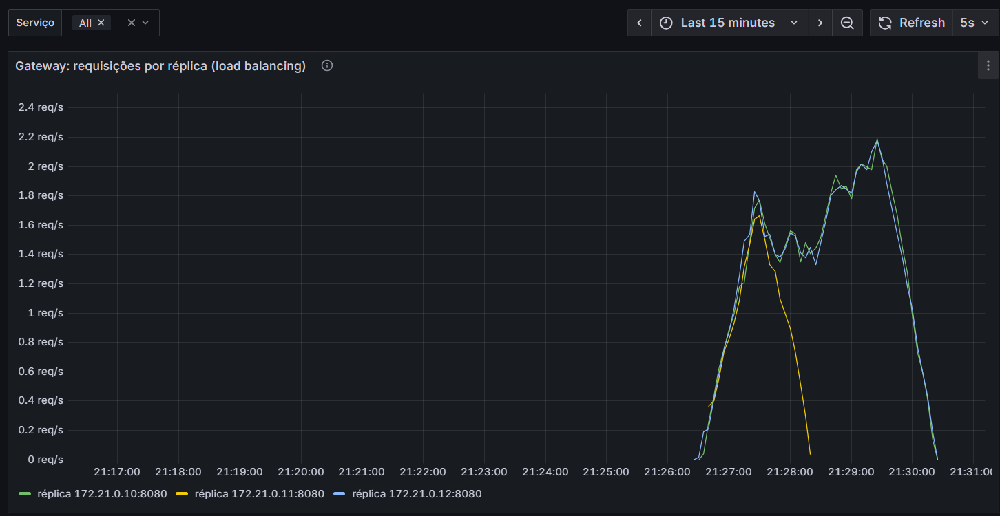

# Gargalo: load balancing (várias réplicas do gateway)

Integrante: **Carlos**. Issue #80.

## Problema

Todo o tráfego do sistema passa pelo **gateway**, e havia **uma réplica só** dele:

- **Ponto único de falha:** se o gateway cai (crash, falta de memória, deploy), o sistema inteiro fica fora do ar, mesmo
  com todos os outros serviços funcionando.
- **Limite de vazão:** uma réplica só usa a CPU de um container. Mais carga não tem para onde ir.

## Solução

Um **load balancer** passa a ser a única porta de entrada e distribui as requisições entre **várias réplicas** do gateway.

```
            cliente
               │  http://localhost:8080
           [ lb: Nginx ]   round-robin + tira da roda a réplica que falha
        ┌──────┼──────┐
   [gateway] [gateway] [gateway]   3 réplicas iguais (GATEWAY_REPLICAS)
        └──────┼──────┘
     auth, account, product, order, exchange
```

| Peça | O que faz |
|------|-----------|
| `docker/compose.yml` | O gateway sobe com `deploy.replicas: 3` e **não publica porta**. O serviço `lb` (Nginx) é o único com porta para fora (`8080`) |
| `docker/nginx/nginx.conf` | `upstream` com o nome `gateway`: o DNS do Docker devolve o IP de cada réplica, e o Nginx distribui em **round-robin**. Com `resolve`, ele consulta o DNS de novo a cada 10 s e acha réplicas novas ou recriadas sem reiniciar |
| Falha de uma réplica | `max_fails=1 fail_timeout=10s`: depois de uma falha, a réplica sai da roda por 10 s. `proxy_next_upstream`: a requisição que pegou a réplica morta é **reenviada para outra** (só GET/HEAD; um POST nunca vai duas vezes, para não duplicar um pedido) |
| `docker/observability/prometheus.yml` | O job do gateway usa `dns_sd_configs`: o Prometheus coleta **cada réplica separada** (label `instance`) |
| Grafana | Painel **"Gateway: requisições por réplica (load balancing)"** no dashboard *PMA26 - Visão geral* |
| `docker/lb-test.sh` | Script que gera a evidência (abaixo) |

**No EKS**, o mesmo papel é do Service `gateway` do tipo `LoadBalancer`: a AWS cria um **ELB** na frente dos pods do
gateway, e o **HPA** varia o número de réplicas (de 1 a 8) conforme a CPU. Ver [Kubernetes](../kubernetes.md) e
[Load test + HPA](../load-test.md).

## Como reproduzir

```bash
docker compose -f docker/compose.yml up --build -d     # 3 réplicas do gateway + lb
./docker/lb-test.sh                                    # distribuição e queda de uma réplica
N=600 DURACAO=120 ./docker/lb-test.sh                  # versão mais longa, para ver no Grafana

# o "antes": uma réplica só
GATEWAY_REPLICAS=1 docker compose -f docker/compose.yml up -d gateway
./docker/lb-test.sh
```

O script manda requisições pelo `lb` e conta no log do Nginx qual réplica atendeu cada uma (`upstream=IP:porta`). Depois
manda requisições sem parar por 20 s, **mata uma réplica aos 5 s** (`docker kill`, como um crash) e conta os erros que
o cliente viu.

## Evidência

Medido no compose local, com `docker/lb-test.sh` (`GET /health-check` pelo `lb`).

**Distribuição** (300 requisições, 3 réplicas no ar):

| Réplica | Requisições |
|---------|------------:|
| gateway-1 | 100 |
| gateway-2 | 100 |
| gateway-3 | 100 |

**Queda de uma réplica** (requisições sem parar, uma réplica morta aos 5 s):

| | Antes: 1 réplica (20 s) | Depois: 3 réplicas + Nginx (rodadas de 20 s) | Depois: 3 réplicas + Nginx (120 s) |
|---|---|---|---|
| Requisições depois da queda | 12 | 113 a 117 | 428 |
| **Erros vistos pelo cliente** | **12 (100%)**: sistema fora do ar até alguém subir o gateway de novo | **0 a 1** (≤ 1%) | **0** |
| Pior latência | 1,1 s (cada requisição esperava o timeout e falhava) | 1,1 s (a requisição reenviada para outra réplica) | 1,7 s (idem) |
| Réplicas que continuaram atendendo | nenhuma | as 2 restantes, divididas igualmente (~69 / 69) | as 2 restantes (217 / 218) |

No Prometheus, as 3 réplicas aparecem como alvos separados do job `gateway`, e o total de requisições por réplica
acompanha o teste (a réplica derrubada fica com menos).

**Distribuição no Grafana** (painel "Gateway: requisições por réplica", `lb-test.sh` com `N=1500`): as 3 linhas, uma por
réplica, ficam praticamente sobrepostas o tempo todo. O Nginx dividiu a carga igualmente.



**Queda no Grafana** (`lb-test.sh` com `DURACAO=120`, a rodada de 120 s da tabela acima): a réplica `172.21.0.11`
(amarela) foi morta às 21:27:37. A linha dela cai até sumir, enquanto as outras duas (verde e azul) sobem de ~1,4 para
~2,0 req/s: passaram a atender o tráfego que era dela, e o cliente não viu nenhum erro. A réplica foi religada no fim do
teste, quando o tráfego já tinha parado, por isso a linha dela não volta no gráfico.



## Limitações (o que observamos)

- **Checagem de saúde passiva.** O Nginx gratuito só percebe que uma réplica caiu quando uma requisição falha nela. Essa
  requisição espera o `proxy_connect_timeout` (1 s) e é reenviada, por isso o pior caso é ~1,1 s. Em algumas rodadas, uma
  requisição falhou com `no live upstreams` no log: o Nginx reenviou, mas não considerou nenhuma outra réplica disponível
  naquele instante. No Kubernetes isso é coberto pela `readinessProbe`, que tira o pod do Service antes de ele receber
  tráfego.
- **Réplica recém-criada.** Uma réplica nova só recebe tráfego depois que o Nginx consulta o DNS de novo (até 10 s). Ao
  subir de 1 para 3 réplicas, a distribuição dos primeiros segundos fica desigual (157 / 72 / 71 numa rodada).
- **Vazão no compose.** As 3 réplicas dividem a CPU da mesma máquina, então o ganho aqui é de **disponibilidade**, não de
  vazão. O ganho de vazão aparece no cluster, com as réplicas espalhadas pelos nós ([Load test + HPA](../load-test.md)).
