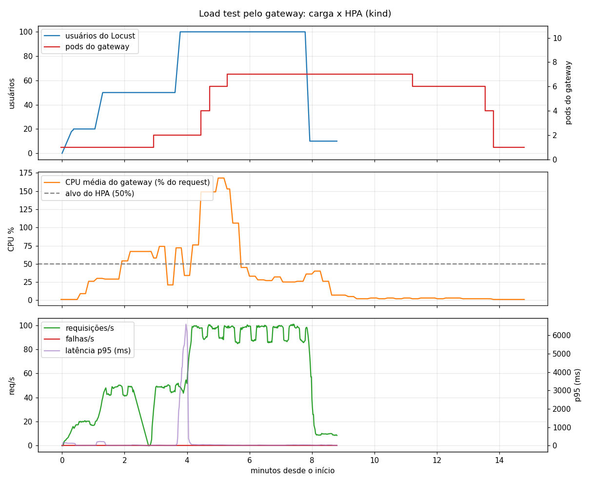

# Load test + HPA

Rubrica: **Load Testing (15%)**, que pede teste de carga contra o gateway + HPA escalando o deployment do gateway + vídeo.
Issues: #68 (épico), #70 (script), #71 (execução), #73 (análise). O vídeo (#72) e a repetição no EKS ainda faltam.

## Ferramenta: Locust

Escolhemos o **[Locust](https://locust.io/)** em vez de JMeter, Gatling ou `hey`:

- O cenário é **código Python** (`load/locustfile.py`), versionado e fácil de ler e explicar. O JMeter usa XML gerado por interface gráfica.
- Simula **usuários com comportamento** (cadastro → login → navegação), não só uma URL repetida. O `hey` (usado no
  [gargalo do cache](gargalos/cache-redis.md)) martela um endpoint só.
- Tem **interface web** com gráficos ao vivo (bom para o vídeo) e gera relatório HTML + CSV no modo headless.
- Roda **em container** (`locustio/locust`), então ninguém precisa instalar nada além do Docker.

## Cenário

Cada usuário virtual:

1. ao entrar, **cria uma conta** (`POST /auth/register`) e **faz login** (`POST /auth/login`), guardando o JWT;
2. depois, em loop, com pausa de 0,5 a 1,5 s entre ações:
   - **consulta uma cotação** (`GET /exchange/{par}`, entre USD/BRL, EUR/BRL e BTC/BRL), com peso 3;
   - **consulta a própria conta** (`GET /accounts/{id}`), com peso 1.

Toda requisição autenticada passa pelo filtro do gateway, que chama o Auth (`/auth/solve`) para validar o token.
Por isso o gateway é o serviço mais exigido, e é ele que o HPA escala.

A carga sobe em degraus (`StagesShape` no `locustfile.py`):

| Tempo | Usuários | Objetivo |
|-------|----------|----------|
| 0:00–1:00 | 20 | aquecimento (a JVM compila o código mais usado) |
| 1:00–3:00 | 50 | passar dos 50% de CPU: o HPA começa a criar pods |
| 3:00–7:00 | 100 | pico |
| 7:00–8:00 | 10 | carga cai; depois o script segue registrando o HPA por 6 min para mostrar a redução |

## Como rodar

Com o sistema de pé no kind ([Kubernetes](kubernetes.md)):

```bash
./load/run.sh                  # 8 min de carga + 6 min registrando o HPA
LOAD_SCALE=0.5 ./load/run.sh   # metade do tempo
LOAD_PEAK=200 ./load/run.sh    # pico de 200 usuários
UI=1 ./load/run.sh             # interface web em http://localhost:8089 (para gravar o vídeo)
```

Para acompanhar ao vivo em outro terminal: `kubectl -n pma26 get hpa gateway -w` e `kubectl -n pma26 get pods -w`.

O `run.sh` salva tudo em `load/results/<data-hora>/` (fora do git): relatório HTML do Locust, CSVs, `hpa.csv`
(CPU e réplicas a cada 5 s), eventos do HPA e o gráfico gerado por `load/plot.py`.

## Resultado no kind (2026-11-18)

Ambiente: kind (1 nó) no Docker Desktop, num notebook. O HPA do gateway vai de 1 a 10 pods, com alvo de 50% de CPU
sobre o `request` de 250m.



Relatório completo do Locust: [report-kind.html](load-test/report-kind.html).

| Endpoint | Requisições | Falhas | p50 | p95 | p99 |
|----------|------------:|-------:|----:|----:|----:|
| `GET /exchange/{par}` | 22.746 | 0 | 11 ms | 30 ms | 60 ms |
| `GET /accounts/{id}` | 7.698 | 0 | 11 ms | 39 ms | 1,3 s |
| `POST /auth/register` | 100 | 0 | 400 ms | 8,6 s | 13 s |
| `POST /auth/login` | 100 | 0 | 310 ms | 9,2 s | 12 s |
| **Total** | **30.644** | **0** | 11 ms | 34 ms | 200 ms |

Pico sustentado de **~100 requisições/s**, com **zero falhas**.

### Linha do tempo do HPA (eventos `SuccessfulRescale`)

| Tempo | CPU média | Pods | O que aconteceu |
|-------|-----------|------|-----------------|
| 0:00 | 1% | 1 | início |
| ~1:55 | 67% | 1 | 50 usuários: CPU passa do alvo |
| 2:59 | 58% | **2** | primeira escala |
| 3:45 | – | 2 | 100 usuários entram |
| 4:30 | 149% | **4 → 6** | CPU muito acima do alvo: o HPA pula vários pods de uma vez |
| 5:20 | 153% | **7** | estabiliza; CPU volta para ~30% |
| 7:50 | – | 7 | carga cai para 10 usuários |
| 11:16 | 2% | **6** | depois de 5 min abaixo do alvo, começa a reduzir |
| 13:52 | 1% | **1** | volta ao mínimo |

## Análise

**1. O HPA funciona e o sistema aguenta a carga sem erro.** Com 100 usuários, o gateway estabilizou em 7 pods, com CPU
média de ~30% e p95 de ~30 ms nas cotações. Nenhuma requisição falhou.

**2. A escala tem atraso, e é aí que a latência sobe.** No pico do gráfico (minuto 4), o p95 chegou a ~6,5 s por cerca
de 30 s. Os 100 usuários entraram quando ainda havia só 2 pods. O HPA precisa de:
- métricas novas do metrics-server, que coleta a cada ~15 s;
- a decisão do HPA, que roda a cada 15 s;
- o pod novo subir: a JVM leva de 30 a 60 s até a `readinessProbe` passar.

Ou seja, **o HPA reage, não antecipa**. Os mais afetados foram register e login, que já são caros por causa do
**BCrypt** (lento de propósito, para dificultar força bruta) e caíram justamente nessa janela.
Possíveis melhorias, a discutir no EKS:
- `minReplicas: 2`: nunca fica com um pod só, e ainda dá alta disponibilidade, ao custo de mais um pod parado;
- alvo de CPU menor (ex.: 40%): escala mais cedo e com mais folga;
- subir a carga de forma gradual (no mundo real, o tráfego raramente salta de 50 para 100 usuários em 10 s).

**3. A redução é lenta de propósito.** O HPA espera 5 minutos estável (`stabilizationWindowSeconds` padrão de scale-down)
antes de remover pods. Isso evita "flapping" (sobe e desce sem parar) quando a carga oscila.

**4. Os outros serviços não viraram gargalo.** Exchange, Account e Auth ficaram com 1 pod cada (não têm HPA) e
aguentaram ~100 req/s. As cotações passam pelo cache Redis ([gargalo](gargalos/cache-redis.md)), então a AwesomeAPI
recebeu no máximo 1 chamada por par a cada 5 min durante todo o teste.

### Observações sobre o ambiente

- O kind roda num notebook, então a CPU dos 10 pods é a mesma máquina. No EKS cada nó tem CPU própria, e os números
  absolutos vão mudar.
- Aos 2:45 há uma queda de ~30 s nos gráficos: **os dois registros** (Locust e `kubectl`) pararam ao mesmo tempo, o
  que indica que a máquina pausou (Docker Desktop). Numa execução anterior isso aconteceu por 3,5 min, e ela foi
  descartada.

## Pendente

- [ ] Repetir no **EKS** (`HOST=http://<LoadBalancer>:8080 NETWORK=host ./load/run.sh`) e comparar.
- [ ] Gravar o **vídeo** (#72): `UI=1 ./load/run.sh` + `kubectl get hpa -w` lado a lado.
- [ ] Testar `minReplicas: 2` e comparar o pico de latência.
